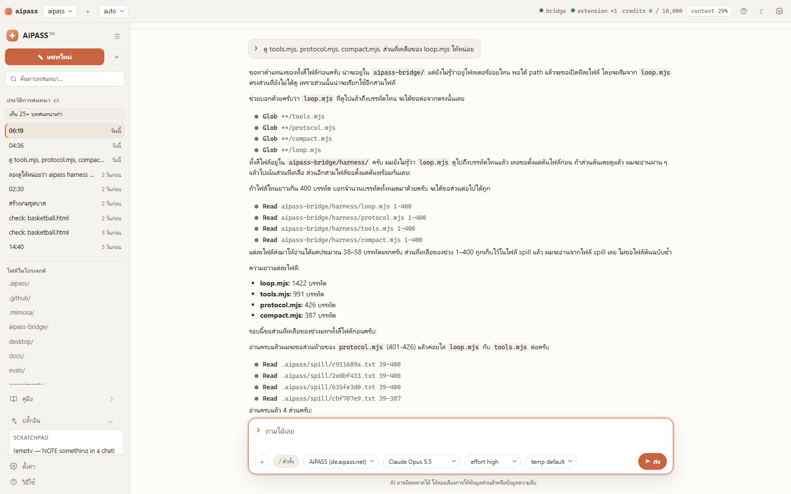

# ✳ aipass

> de.aipass.net from a desktop window, from your terminal, and from any OpenAI-compatible client — with live streaming, an autonomous file-editing agent, and a zero-dependency bridge.

<p align="left">
  = 22" />
  
  
  
</p>



---

## Contents

- [Where this stands](#where-this-stands)
- [Architecture](#architecture)
- [Quick start](#quick-start)
- [The desktop window](#the-desktop-window)
- [The terminal](#the-terminal)
- [The agent](#the-agent)
- [The bridge](#the-bridge)
- [Configuration](#configuration)
- [Documentation](#documentation)
- [Repo layout](#repo-layout)
- [Development](#development)
- [Credits & license](#credits--license)

## Where this stands

aipass is one project: a desktop window, a terminal client and a file agent
around de.aipass.net, sharing one settings file and one harness. Most of what
you use day to day was written here.

The terminal bridge, the Chrome extension and the CLI started life as
**[niawjunior/aipass-bridge](https://github.com/niawjunior/aipass-bridge)** by
[niawjunior](https://github.com/niawjunior) — a MIT-licensed project this
repository continues. That code (bridge, extension, CLI) stays under
niawjunior's copyright, credited in [LICENSE](./LICENSE). Everything added on
top — the desktop window, the harness, the sessions, the agent protocol — is
this repository's own work. Influences beyond that: the session storage borrows
its JSONL-per-session shape from the pi coding agent, and the permission/hook
vocabulary and the tool-writing guidance (token-efficient results, head+tail
clipping) follow the published agent-tool literature. Those are influences on
the design, not code taken from anywhere.

What sits on top:

- a **desktop window** — a full app around the same bridge: projects, a chat
  list, transcripts that resume, per-file diff approval, playbooks, plugins, a
  file panel. Thai-first, dark and light.
- a **longer-lived harness** — sessions on disk, plan cards, helpers, a
  compaction budget you can see, permission path rules, plugins.
- **one settings file** — `~/.aipass/settings.json`, shared by the window, the
  CLI and the agent, so a change is true everywhere immediately.

## Architecture

```text
desktop window ─┐
terminal ───────┼──HTTP + SSE──▶ bridge (node, zero dependencies) 127.0.0.1:8787
any /v1 client ─┘                    │  SSE: jobs out, POST: deltas back
                                     ▼
                      Chrome extension (MV3) + offscreen keepalive
                                     │  chrome.runtime
                                     ▼
                      de.aipass.net tab ──▶ /actions/send-message/<id>
```

No credentials are stored anywhere. Every request runs as ordinary page
JavaScript inside your own logged-in tab, so the site's session cookie rides
along by itself — the bridge never sees your aipass password. (It has a
loopback token of its own; see *The bridge*, below.)

## Quick start

Node ≥ 20. Nothing to install: the bridge, the harness, the window and the
tests run on node builtins alone.

The fastest path on a fresh machine is one command:

```bash
aipass setup            # or: npm run setup
```

It checks Node, puts `aipass` on your PATH, mints the loopback token (and copies
it to your clipboard), starts the bridge, and opens the extension and site pages
so you can finish the one-time browser steps. Re-run it any time — it is
idempotent. The manual steps below are what it automates.

### 1. The extension (once)

1. Open `chrome://extensions`, turn on **Developer mode**, **Load unpacked**,
   and pick `aipass-bridge/extension`.
2. Open https://de.aipass.net/chat and log in. Keep the tab around while you
   work — it is what does the talking.
3. The bridge mints a loopback token at `~/.aipass/.token` and prints the path
   when it starts. Open the extension popup → **Advanced**, paste the file's
   contents into **Loopback token**, save. One time per browser; without it
   the popup says the bridge needs a token.
4. Recommended: Chrome **Settings → Performance → Always keep these sites
   active → add `de.aipass.net`**, so a long run is never frozen mid-stream.

### 2. A client

```bash
npm run desktop     # the desktop window (starts the bridge itself if needed)
# or
aipass dev          # the bridge alone, logs in this terminal (Ctrl+C to stop)
aipass              # the chat TUI, in a second terminal
```

`aipass` lives at `aipass-bridge/bin/aipass.mjs`; without putting it on your
PATH, `node aipass-bridge/bin/aipass.mjs` is the same thing. Install scripts sit
beside it (`install.ps1` on Windows, `install.sh` elsewhere).

## The desktop window

`npm run desktop` (or `aipass desktop`) starts a small local backend on
`127.0.0.1:8790` and opens the window. `desktop/ui/` is plain HTML/CSS/JS —
no build step, open it in a browser to poke at a change. To produce the native
app instead: `npm run tauri:dev` / `npm run tauri:build` (see
[`desktop/README.md`](./desktop/README.md)).

What it holds:

- **Sessions** — resume, rename, fork; transcripts replay from disk, per
  project.
- **Diffs per file** — the agent stages edits in an overlay; you see real diffs
  and write only the files you tick.
- **Plan cards** and permission modes — `ask` / `auto` / `yolo`, with plan mode
  on top (`Shift+Tab` cycles ask → auto → plan).
- **The effort chip** — the thinking level (`off` … `max`) sits in the composer
  next to the model select, because how hard a model thinks is a per-message
  decision, not a buried setting.
- **Files and attachments** — walk the project tree, attach files, paste or
  drop images.
- **Plugins** — one `.mjs` per plugin in `~/.aipass/plugins`; a working
  scratchpad example ships in
  [`desktop/plugins-example/notes.mjs`](./desktop/plugins-example/notes.mjs).
- **Thai-first, dark/light**, with credit and context meters in the header.

Settings live in `~/.aipass/settings.json`; the gear in the header edits them as
a form, and `settings.get` / `settings.set` do the same thing from a script.

## The terminal

`aipass` opens the chat TUI. Streaming markdown, reasoning folds, prompt
queueing while a run is going, `Esc` to stop, attachments, and a slash palette
that opens the moment you type `/`.

| Slash command | Does |
|---|---|
| `/model`, `/models` | switch model / list what the account can talk to |
| `/thinking` | reasoning level: `off` · `low` · `medium` · `high` · `max` |
| `/conversations`, `/switch`, `/new` | move between conversations |
| `/tone`, `/format`, `/language` | how replies are written |
| `/image`, `/file`, `/clip` | attach media to the next message |
| `/styles`, `/image-style`, `/video-style` | generation style presets |
| `/credits`, `/quota` | credit quota of the account |
| `/agent`, `/agent-root` | hand the turn to the file agent / set its root |
| `/doctor`, `/status` | diagnostics and connection status |
| `/help`, `/clear`, `/stop` | palette help / clear the screen / stop the run |

## The agent

`aipass agent "task"` — or a run in the window — turns the model into a file
agent working in the current project. The model asks, the harness acts:

| Request | What happens |
|---|---|
| `NEED dir <path>` · `NEED file <path> [start-end]` | list a directory / read a file, a screen at a time |
| `SEARCH <text>` | grep-style search, `.gitignore` aware, big files skipped |
| `GLOB <pattern>` | find files by pattern |
| `SYMBOLS <file>` · `DEF <name>` · `REFS <name>` | code navigation: list a file's declarations, find a definition, find references (zero-dependency regex index) |
| `GIT <subcommand>` | read-only git inspection |
| `FETCH <url>` | read a URL — private and internal hosts refused |
| `WEB <query>` | live web search with citations |
| `CREATE` · `EDIT` · `DELETE` · `MOVE` | staged file changes — only applied per your approval |
| `RUN … END` | a shell command — only when shell is allowed |
| `ATTACH <file>` | send a file along with the message |
| `SUBAGENT ... END` | hand a self-contained piece to a helper (`role: verifier/reviewer/summariser`); add `background: true` to run it beside you, then poll with `JOBS` |
| `MCP__<server>__<tool>` | a tool from a configured MCP server (stdio) — see `~/.aipass/mcp.json` |

Guardrails that keep long tasks honest: writes are staged into an overlay and
shown as diffs before they land; `RUN` is gated by the permission mode and
`allowRun`; per-run caps on steps, tool calls and wall-clock; path rules (the
**กฎไฟล์** page in the window) can veto reads and writes by glob; and the WAF
module keeps risky spellings shortened on the way out and restores them on the
way in, so an upstream block doesn't silently kill a run.

Extra capabilities available to the agent: **code navigation**
(`SYMBOLS`/`DEF`/`REFS` over a zero-dependency regex index), **MCP tools**
(`MCP__<server>__<tool>` from servers in `~/.aipass/mcp.json`), **background
helpers** (`SUBAGENT` with `background: true`, polled via `JOBS`), **cross-session
memory** (facts persisted per project, loaded into the next session's first
turn), and **test-time scaling** (`aipass scale "task" --n N`). Each has an
off-switch or is opt-in; see `docs/MATURITY.md`.

## The bridge

The bridge is OpenAI-compatible, so anything that speaks the API can use your
AIPASS account through your browser session:

- `POST /v1/chat/completions` — streaming and not
- `GET /v1/models` — what the account can talk to

It binds `127.0.0.1:8787` by default. Every route except the health probes
(`/status`, `/health`) requires the loopback token minted once at
`~/.aipass/.token` — the bridge prints the path at boot, and the extension
popup (**Advanced**) takes the token once. The CLI and the desktop backend
read the file themselves. `AIPASS_TOKEN` sets an explicit value;
`AIPASS_REQUIRE_AUTH=0` goes back to tokenless, loopback-only operation.

## Configuration

`aipass-bridge/.env.example` has the full list. The usual ones:

| Variable | Default | Purpose |
|---|---|---|
| `AIPASS_PORT` / `AIPASS_HOST` | `8787` / `127.0.0.1` | where the bridge listens |
| `AIPASS_MODEL` | `gemini-3.1-flash-lite` | model when a request names none |
| `AIPASS_MODEL_FILTER` | `chat` | `all` also lists image and video generators |
| `AIPASS_CONVERSATION_ID` | — | pin one conversation instead of "most recent" |
| `AIPASS_ASSISTANT_ID` | — | bind new conversations to a custom assistant |
| `AIPASS_TOOL_VISIBILITY` | `reasoning` | `reasoning` · `text` · `off` |
| `AIPASS_IDLE_TIMEOUT_MS` | `180000` | when a quiet run counts as idle |
| `AIPASS_MEDIA_TIMEOUT_MS` | `900000` | how long a generation may take |
| `AIPASS_TOKEN` / `AIPASS_REQUIRE_AUTH` | `~/.aipass/.token` / on | loopback bearer token (see *The bridge*) |
| `AIPASS_CORS_ORIGIN` | — | allow one browser origin (off by default) |

The window and the CLI keep their state in `~/.aipass/` (settings, sessions,
plugins, uploads, logs).

## Documentation

The design and operations docs live in [`docs/`](./docs/):

| Doc | What it holds |
|---|---|
| [`docs/HARNESS_DESIGN.md`](./docs/HARNESS_DESIGN.md) | the system end to end: bridge, window, backend, harness — who wires what and why |
| [`docs/LOOP_DESIGN.md`](./docs/LOOP_DESIGN.md) | the agent loop itself: stage map, guards, stop reasons, the event stream |
| [`docs/SPEC_CHECKER.md`](./docs/SPEC_CHECKER.md) | the checker: the read-only pass a `DONE` earns, verdicts, the declared check |
| [`docs/SPEC_EVALS.md`](./docs/SPEC_EVALS.md) | the eval runner: task fixtures, live and replay modes, scoring |
| [`docs/EXPERIMENTS.md`](./docs/EXPERIMENTS.md) | the experiment queue: sources, records, budgets, when an experiment ends |
| [`docs/TECH_STACK.md`](./docs/TECH_STACK.md) | what runs where, and the reasons each piece is what it is |
| [`docs/DATA_FORMATS.md`](./docs/DATA_FORMATS.md) | what lands on disk: settings, session JSONL, the token, uploads, eval results |
| [`docs/TROUBLESHOOTING.md`](./docs/TROUBLESHOOTING.md) | when something is broken: doctor, the common failures, where the logs are |
| [`docs/RELIABILITY.md`](./docs/RELIABILITY.md) | what healthy means: the SLIs and their targets, the error budget, degradation modes |
| [`docs/RELEASE.md`](./docs/RELEASE.md) | versioning, the release checklist, upgrade and rollback, dependency review |
| [`docs/MATURITY.md`](./docs/MATURITY.md) | capability status — production vs experimental, owners, what changes a status |
| [`docs/TEST_PLAN.md`](./docs/TEST_PLAN.md) | the test design: layers L1–L5, cases, pass criteria, what each layer cannot prove |

The behavior-level change history is [`CHANGELOG.md`](./CHANGELOG.md); it is
what release notes are cut from.

Component-level docs sit next to their code:
[`aipass-bridge/README.md`](./aipass-bridge/README.md) (bridge, CLI, protocol),
[`aipass-bridge/docs/DOCS.md`](./aipass-bridge/docs/DOCS.md) and
[`desktop/README.md`](./desktop/README.md) (the window and native builds). For
contributing see [`CONTRIBUTING.md`](./CONTRIBUTING.md); for reporting a
vulnerability, [`SECURITY.md`](./SECURITY.md).

## Repo layout

```text
aipass/
├─ aipass-bridge/       the bridge, the CLI and the harness
│  ├─ bridge/           local HTTP + SSE server (zero dependencies)
│  ├─ harness/          agent core: loop, tools, protocol, permissions, waf
│  ├─ extension/        Chrome MV3 worker + content script + keepalive
│  ├─ bin/aipass.mjs    the `aipass` command
│  ├─ chat.mjs          the terminal chat client
│  └─ agent.mjs         the file agent
├─ desktop/             the window
│  ├─ main.mjs          bridge (if needed) + backend on :8790 + window
│  ├─ ui/               plain HTML/CSS/JS — no build step
│  ├─ src-tauri/        native shell: tray, sidecar node, bundles
│  └─ plugins-example/  a plugin worth copying
├─ docs/                design and operations docs — see Documentation above
├─ evals/               task fixtures — smoke set, holdout, Thai/English pairs
├─ scripts/             test runner, QA loop, verify, evals
├─ public/              static pages and the README image
└─ package.json         npm run shortcuts — nothing to install
```

## Development

```bash
npm run setup   # first-run machine setup: Node, PATH, token, bridge, browser pages
npm test        # the whole suite (bridge, extension, harness, window logic)
npm run check   # npm test and npm run qa in one go — the pre-push pair
npm run qa      # static checks + suite + fake-DOM window + live status
npm run verify  # suite + a sandboxed live smoke of the bridge and backend
npm run evals   # score agent runs against task checks
```

The tests are plain `node --test` — no framework, no dependencies.

## Credits & license

Original project: **[niawjunior/aipass-bridge](https://github.com/niawjunior/aipass-bridge)**
by [niawjunior](https://github.com/niawjunior). This continuation is released
under the [MIT License](./LICENSE).
